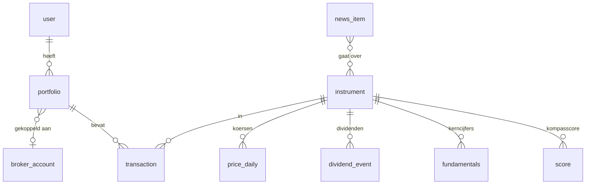

# Datamodel

Opgeslagen worden alleen **brongegevens**. Alles wat de app toont, wordt daaruit berekend.

| Tabel | Velden | Toelichting |
|---|---|---|
| `user` | id, email, base_currency, created_at | Fase 2 (login) |
| `portfolio` | id, user_id, name, broker_account_id?, base_currency | Meerdere per gebruiker |
| `broker_account` | id, broker, external_id, last_sync_at | Fase 2 (brokerkoppeling) |
| `instrument` | id, isin, ticker, name, exchange, currency, sector, industry, country | Aandeel, ETF of fonds |
| `transaction` | id, portfolio_id, instrument_id, type (BUY/SELL/DIVIDEND/FEE/CASH), trade_date, quantity, price (lokaal), fx_rate, fees, tax | Bron van alle berekeningen |
| `price_daily` | instrument_id, date, close, volume | Slotkoersen |
| `fx_daily` | pair, date, rate | Bijv. EURUSD |
| `dividend_event` | instrument_id, ex_date, pay_date, amount_unadjusted, currency (van het dividend, niet van de notering), status (declared/estimated) | Voor kalender en prognose. Recht = positie aan het eind van de dag vóór ex_date |
| `split` | instrument_id, date, ratio (nieuwe aandelen per oud aandeel) | Uit EODHD /splits. Aantallen en dividend per aandeel van vóór de split worden hiermee omgerekend |
| `fundamentals` | instrument_id, as_of, pe, eps_growth_fc, roe, debt_equity, payout_ratio | Voor "posities op één lijn" |
| `score` | instrument_id, as_of, valuation, growth, past, health, dividend (0–6), fair_value, fair_value_method | Kompasscore en waardering |
| `benchmark` | code (AEX, AMX, MSCI World), date, close | Vergelijking |
| `news_item` | id, instrument_ids[], category, title, summary, url, published_at | IEX-artikelen per positie |

## Berekend (niet opgeslagen)

- Posities en gemiddelde kostprijs (gemiddelde-kostprijsmethode)
- Waarde- en inlegreeks per week
- IRR (XIRR over alle kasstromen) en tijdgewogen rendement (TWR)
- Gerealiseerd resultaat en valuta-effect
- Volatiliteit, bèta, maximale daling, Sharpe en Sortino (3 jaar, weekrendementen)
- Correlatiematrix
- Dividendprognose 12 maanden (huidige posities × verwacht dividend, na 15% bronbelasting)
- Gewogen kompasscore

## Opties en ETF's (toegevoegd)

| Tabel | Doel | Belangrijkste velden |
|---|---|---|
| option_contract | Euronext-optieserie | underlying_id, type (CALL/PUT), strike, expiry, multiplier (10 voor Mini AEX, 100 voor aandelen), settlement |
| option_trade | Elke optietransactie | portfolio_id, contract_id, action (BTO, STO, BTC, STC, EXP, ASSIGN), contracts, premium, fee, strategy |
| etf_exposure | Doorkijk van ETF's | instrument_id, as_of, dimension (country, sector, currency), key, weight |

In het prototype worden optiepremies en Greeks met Black-Scholes berekend op de echte koers van de onderliggende waarde. Met Infront kunnen dit echte Euronext-optiekoersen worden.

## Grootboek voor brokerdata (fase 2)

De rekenkern staat in `public/js/ledger.js` en is getest met een testset per valkuil (`npm test`). Alles wat een broker aanlevert wordt een onveranderlijke boeking in `ledger_entry`; posities, kas, resultaten en controles worden er steeds opnieuw uit berekend.

| Veld | Toelichting |
|---|---|
| id, portfolio_id, account | Account = broker-rekening; kas wordt per account en per valuta bijgehouden |
| type | DEPOSIT, WITHDRAWAL, BUY, SELL, DIVIDEND, DIVIDEND_REVERSAL, TAX_REFUND, STOCK_DIVIDEND, SPLIT, SPINOFF, MERGER, ISIN_CHANGE, TRANSFER_IN, TRANSFER_OUT, FX, FEE, INTEREST |
| date, ex_date, pay_date | Recht op dividend = positie aan het eind van de dag vóór ex_date. Corporate actions gaan binnen een dag vóór transacties |
| instrument_id, new_instrument_id | Bij spin-off, fusie en ISIN-wijziging |
| qty, price, ccy, fx | Ruwe aantallen en prijzen zoals de broker ze boekte; fx = euro per eenheid valuta, tegen de koers van de broker |
| gross, tax, tax_country, kind | Dividend bruto en ingehouden belasting apart; kind = regular, special, capital_return, capital_gain, interest |
| fee, fee_ccy, cash_amount, cash_ccy | Wat er echt van welke kasrekening af ging (automatische valutawissel) |
| ratio, cost_fraction, cash_per_share, cash_in_lieu | Corporate actions: verhouding, verdeling van de kostprijs, contanten |
| cost, cost_local, orig_date | Inkomende overboeking: oorspronkelijke kostprijs en aankoopdatum (optioneel) |
| src_broker, src_ext_id, src_line, imported_at, edited_at | Herkomst. (broker, ext_id) is uniek: opnieuw importeren levert geen dubbele boekingen op |

`instrument_identity` (instrument_id, isin, ticker, exchange, valid_from, valid_to) houdt ISIN-, ticker- en beurswijzigingen bij, zodat een positie doorloopt.

**Controles bij elke import:** aansluiting van aantallen en kas per valuta met het brokeroverzicht, verkoop van meer dan je hebt, prijs ver van de slotkoers (factor 100 = pence/pond, factor van een split = split niet verwerkt), dividend dat verwacht werd maar niet binnenkwam, dividend zonder positie, dubbel geboekt dividend, bronbelasting boven 50% of boven het verdragstarief, een split uit de markt die niet geboekt is, spin-offs en fusies zonder verdeling van de kostprijs, overboekingen zonder kostprijs.

**Kostprijsmethode:** lots worden altijd bewaard; gemiddelde kostprijs (standaard) of FIFO is een instelling.
