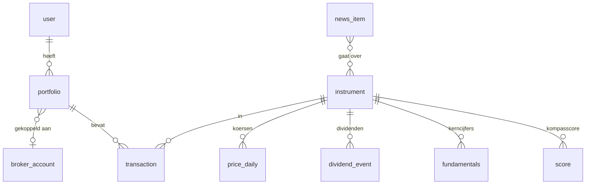

# Datamodel

Opgeslagen worden alleen **brongegevens**. Alles wat de app toont, wordt daaruit berekend.

| Tabel | Velden | Toelichting |
|---|---|---|
| `user` | id, email, base_currency, created_at | Fase 2 (login) |
| `portfolio` | id, user_id, name, broker_account_id?, base_currency | Meerdere per gebruiker |
| `broker_account` | id, broker, external_id, last_sync_at | Fase 2 (brokerkoppeling) |
| `instrument` | id, isin, ticker, name, exchange, currency, sector, industry, country | Aandeel, ETF of fonds |
| `transaction` | id, portfolio_id, instrument_id, type (BUY/SELL/DIVIDEND/FEE/CASH), trade_date, quantity, price (lokaal), fx_rate, fees, tax | Bron van alle berekeningen |
| `price_daily` | instrument_id, date, close, volume | Slotkoersen |
| `fx_daily` | pair, date, rate | Bijv. EURUSD |
| `dividend_event` | instrument_id, ex_date, pay_date, amount (lokaal), status (declared/estimated) | Voor kalender en prognose |
| `fundamentals` | instrument_id, as_of, pe, eps_growth_fc, roe, debt_equity, payout_ratio | Voor "posities op één lijn" |
| `score` | instrument_id, as_of, valuation, growth, past, health, dividend (0–6), fair_value, fair_value_method | Kompasscore en waardering |
| `benchmark` | code (AEX, AMX, MSCI World), date, close | Vergelijking |
| `news_item` | id, instrument_ids[], category, title, summary, url, published_at | IEX-artikelen per positie |

## Berekend (niet opgeslagen)

- Posities en gemiddelde kostprijs (gemiddelde-kostprijsmethode)
- Waarde- en inlegreeks per week
- IRR (XIRR over alle kasstromen) en tijdgewogen rendement (TWR)
- Gerealiseerd resultaat en valuta-effect
- Volatiliteit, bèta, maximale daling, Sharpe en Sortino (3 jaar, weekrendementen)
- Correlatiematrix
- Dividendprognose 12 maanden (huidige posities × verwacht dividend, na 15% bronbelasting)
- Gewogen kompasscore
